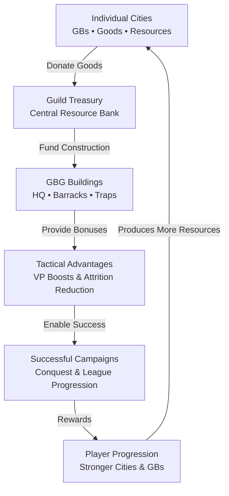

## Core Concepts

- [[Summary]]
- [[GBG Battleground Buildings]]
- [[The Strategic Primacy of Buildings in Guild Battlegrounds]]
- [[The Tactical Importance of On-Map GBG Buildings]]

## Strategic Archetypes: VP-Centric vs. Attrition-Centric

A successful GBG campaign requires a seamless integration of on-map tactical decisions and the logistical support from individual players' cities. This synergy gives rise to distinct guild strategies.

#### A. The VP-Centric vs. Attrition-Centric Strategies

Guilds generally adopt one of two primary strategies, which dictate their building choices and overall approach.

1. **VP-Centric (Competitive) Strategy**: This strategy is for guilds aiming to secure a top ranking. The primary objective is to maximize Victory Points per hour. The strategy centres on immediately constructing the highest-tier HQ building and then focusing on conquering and fortifying high-value, central sectors with multiple building slots. Provincial building choices will prioritize those that generate Victory Points, such as the Fortified Guild Command Post, or those that reduce attrition for advancing units, like Barracks. The goal is to secure a dominant position and hold it for the duration of the season.
    
2. **Attrition-Centric (Farming) Strategy:** This strategy prioritizes individual player rewards over guild ranking. The objective is to maximize the number of fights each member can complete. Building choices will focus on attrition-reducing structures to enable members to fight as many battles as possible and farm rewards like FPs and goods.
    

This strategic divergence is a crucial consideration for guild leaders and players alike. It highlights that there is no one-size-fits-all approach to GBG; the optimal building strategy is dependent on the guild's ultimate objective.

#### B. The Economic Model of GBG: The "Guild as a Business" Model

The operation of GBG reveals a clear economic cycle. Individual player cities, through their GBs and other buildings, are the primary source of resources. These resources, particularly goods, are donated to the guild treasury. The guild treasury, in turn, acts as the central bank that funds the construction of on-map buildings. These buildings then provide the tactical advantages—VP boosts and attrition reduction—that enable the guild to succeed in its campaigns. The rewards from these successful campaigns, such as league promotions and daily chests, feed back into player progression, strengthening the individual cities and restarting the cycle. This demonstrates that a successful guild is fundamentally a well-oiled economic machine, where every member's city serves a specific role in funding the collective effort.

| Guild Goal      | Primary Objective           | Recommended HQ Building               | Recommended Provincial Building                   | Rationale                                                                                                                                                                               |
| --------------- | --------------------------- | ------------------------------------- | ------------------------------------------------- | --------------------------------------------------------------------------------------------------------------------------------------------------------------------------------------- |
| **Competitive** | Maximise Guild Ranking & VP | Fortified Guild Fieldcamp             | Fortified Guild Command Posts, Fortified Barracks | The HQ building's massive VP multiplier and the provincial buildings' combined VP boosts and attrition reduction are necessary for out-earning other guilds and securing key positions. |
| **Farming**     | Maximise Member Rewards     | Advanced Guild Garrison (Less costly) | Barracks, Guild Fieldcamps                        | A lower-cost HQ option combined with attrition-reducing provincial buildings allows members to fight more battles for personal rewards with less collective investment of goods         |
The farming strategy does not seek league dominance. It seeks optimum member return on goods invested.

# Guild and Player Recommendations #

## Actionable Recommendations for Guilds and Players

Based on the analysis, a series of clear recommendations can be made for both guild leadership and individual members.

#### A. Strategic Recommendations for Guild Leadership

### Key Priorities for Guild Leaders

1. Build the strongest HQ available as early as possible.
2. Secure central, high-value provinces before peripheral sectors.
3. Foster a treasury economy through member contribution and GB development.

Guild leaders should prioritize the immediate construction of the top-tier HQ building at the start of every GBG season, even if it requires a significant initial investment of goods and diamonds. The return on this investment far outweighs the cost of competing for a lower-tier ranking. Strategic expansion should focus on securing high-value central provinces, which often have more building slots and higher base VP values, and fortifying them with attrition-reducing or VP-boosting structures.

A successful GBG guild functions as an ecosystem. Individual cities generate resources, key Great Buildings support the guild treasury, and treasury goods fund the infrastructure that enables battlefield success.

Leaders must also foster an economy that supports these actions by encouraging members to build and level GBs that contribute to the guild treasury, such as the Arc and Observatory. 
##### B. Player-Specific Investment Priorities

For many active GBG players, Great Building development follows a  broadly recognisable pattern. 
- Early investment often focuses on the Arc due to its contribution to rewards and guild support. 
- Combat-oriented players frequently add the Statue of Zeus as an affordable source of attack bonuses. 
- As cities mature, buildings such as Alcatraz and the Arctic Orangery become increasingly valuable for sustaining large volumes of combat. 
- Later, the Blue Galaxy is often used to amplify collections and accelerate city development. 

However, the optimal progression varies according to a player's objectives, play style, and stage of development.

The analysis demonstrates that buildings are not a peripheral mechanic in Forge of Empires Guild Battlegrounds but the very core of its strategic depth. They are the nexus between individual city development and collective guild success, defining a guild's economic strength, military endurance, and its ultimate standing in the league. Success in GBG is a testament to a guild's ability to operate as a cohesive economic and tactical unit, fuelled by the contributions of each player's strategically developed city. Victory is not merely about fighting; it is about building a city and a guild that are meticulously optimized to succeed.