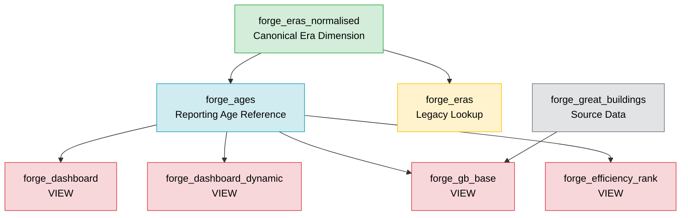

# Era and Age Management

## Purpose

The Forge database contains multiple era-related tables that serve different purposes. To prevent data drift, reporting inconsistencies, and maintenance issues, all era management must follow the source hierarchy defined in this document.

## Authority Statement

The canonical source of all Forge of Empires era metadata is:

`forge_eras_normalised`

All future era additions, renames, classifications, and sequence changes must be applied here first.

The following tables must remain synchronised with the canonical source:

- forge_ages
- forge_eras

The following reporting objects derive age-related information from those source tables and should never be updated directly:

- forge_dashboard
- forge_dashboard_dynamic
- forge_gb_base
- forge_efficiency_rank

---

## Architecture Diagram

---

## Table Definitions

### forge_eras_normalised

**Role:** Canonical Era Dimension

**Purpose:** Master definition of all Forge of Empires eras.

#### Key Columns

- era_id
- era_code
- era_name
- era_group
- era_sequence

#### Responsibilities

- Official era names
- Era abbreviations
- Era grouping
- Era progression order
- Analytics and reporting support

#### Maintenance Rule

All new FoE eras must be added here first.

---

### forge_ages

**Role:** Reporting Age Reference

**Purpose:** Provides age names and descriptions used by reporting objects and dashboard views.

#### Key Columns

- age_id
- age_name
- description

#### Notes

Contains one additional record:

`No Age`

This record does not exist in the other era tables.

#### Maintenance Rule

Must always be synchronised with:

`forge_eras_normalised`

---

### forge_eras

**Role:** Legacy Lookup Table

**Purpose:** Lightweight compatibility lookup.

#### Key Columns

- era_id
- era_name

#### Maintenance Rule

Must be updated whenever new eras are added to:

`forge_eras_normalised`

---

## Reporting Views

The following objects are views and should never be updated directly:

- forge_dashboard
- forge_dashboard_dynamic
- forge_gb_base
- forge_efficiency_rank
- forge_investment_simulator
- forge_leveling_path
- forge_lock_values

